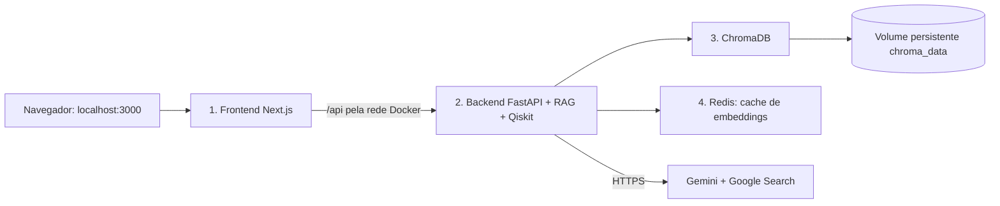

# GrowUp — QuantumOne

A versão **Beta-v1.1** amplia a análise e otimização de circuitos OpenQASM 2 e Python/Qiskit. O processamento determinístico usa Qiskit e pode ser executado apenas com o código no editor.

A interface usa a [versão 3.1 do frontend QuantumOne](https://github.com/julia-deeck/agente-rag-otimizacao-codigo-front/tree/2578e3f6a17bfcc35f0c00efe61a809365085456). O editor envia o arquivo selecionado ao Qiskit. Perguntas e anexos de texto usam a conversa da API, e o histórico, os projetos e as preferências ficam no navegador.

## Iniciar e abrir

Abra PowerShell nesta pasta:

```powershell
docker compose up --build -d --wait
docker compose ps
```

Frontend: http://localhost:3000

Swagger da API: http://localhost:8000/docs

O primeiro build baixa dependências e modelo de embeddings. A API fica pronta após carregar o modelo. A base oficial é alimentada automaticamente em segundo plano na primeira inicialização e atualizada semanalmente. Consulte o andamento:

```powershell
docker compose exec api python -m rag.sincronizar_conhecimento --status
```

A base validada em 13/11/2026 tem 21 fontes oficiais e 2 uploads preservados, totalizando 5.073 trechos. O catálogo inclui circuitos, portas, parâmetros, medições, estados, operadores, primitivas, OpenQASM e transpiração. Snapshots ficam no volume api_data. Os bancos antigos permanecem separados. Consulte [Conhecimento e busca web](docs/CONHECIMENTO-WEB.md) para atualização manual, limites, backup e reconstrução sem internet.

**Busca ampla sob demanda:** a opção **Buscar também na web** usa Google Search via Gemini e mostra fontes identificadas como locais ou web. Resultados web não são gravados no Chroma. Desative a opção para usar somente a base local. Quando a API informa indisponibilidade da busca web, a interface consulta a documentação local e registra essa condição no relatório.

**Dependência atual:** o teste real do Google retornou 429 (cota esgotada). A integração está implementada; respostas com busca web dependem de cota/faturamento e suporte da conta. O frontend mostra a falha, sem simular uma resposta. [Validação desta etapa](docs/VALIDACAO-CONHECIMENTO.md).

## Organização



- Frontend: porta 3000, chamadas pela mesma origem, encaminhadas à API interna.
- API: porta local 8000, contratos anteriores preservados; RAG e Qiskit no mesmo container.
- ChromaDB: coleção única `qiskit_documentacao_multilingue`, sem porta publicada no host. Modelo `sentence-transformers/paraphrase-multilingual-MiniLM-L12-v2`, normalizado, 384 dimensões.
- Redis: somente na rede interna, sem porta publicada. Cache de vetores por hash do modelo/texto, expiração de 1 hora e limite de 128 MB. Reiniciá-lo descarta cache sem perder documentos. Se estiver indisponível durante uma requisição, embeddings são calculados normalmente.
- Volumes existentes `chroma_data`, `model_cache` e `api_data` preservam banco, modelo baixado, avaliações e snapshots documentais. Redis não é fonte de dados persistentes.

## Usar a interface

Preencha o código OpenQASM 2 ou Python/Qiskit, a pergunta, ou ambos e clique em Analisar.
- Código: validação, transpilação em nível 3 e métricas de operações e profundidade. A equivalência matricial é verificada quando o circuito cabe no orçamento de verificação.
- Pergunta: RAG + Gemini com o top_k selecionado em Configurações.
- Ambos: Qiskit e explicação documental. Se somente a explicação falhar, as métricas são preservadas e a falha é indicada.
- Resultados: fontes com painel de detalhes, circuito otimizado, copiar resultado e voltar ao editor.
- Processamento: o serviço encerra o worker ao atingir o prazo ou detectar que a conexão foi fechada.
- Erros: entrada inválida, evidência insuficiente ou serviço indisponível, com retry e entrada preservada.

Os painéis **Diff**, **Qiskit** e **Fontes** mostram a comparação do arquivo analisado, as métricas calculadas e os trechos recuperados. Digite `ajuda` no terminal para listar os comandos disponíveis. Documentos da base compartilhada podem ser importados pelo Swagger. Os anexos da conversa fornecem contexto apenas ao pedido em que forem incluídos.

## Contas e e-mail

O cadastro e a alteração de senha usam a API. As credenciais ficam no volume `api_data`. Projetos, histórico, foto e preferências pertencem ao workspace deste navegador. Exporte o backup em **Configurações** para levá-lo a outro navegador.

No Compose local, o Mailpit recebe os códigos de confirmação. [Abrir a caixa de testes](http://localhost:8025). Para entrega em caixas reais, configure `SMTP_HOST`, `SMTP_PORT`, `SMTP_STARTTLS=1`, `SMTP_FROM`, `SMTP_USER` e `SMTP_PASSWORD` no ambiente da API. O fluxo usa um código de seis dígitos válido por dez minutos e um token de uso único para a troca de senha.

## Credencial e modelo

A credencial está somente no `.env` local, ignorado pelo Git e pelos builds. Nunca use chave em variáveis NEXT_PUBLIC ou no navegador. Em outra instalação, copie `.env.example` para `.env` e preencha GEMINI_API_KEY. Preserve um .env existente.

Modelo configurado: `gemini-3.1-flash-lite`. Na validação de 11/11/2026, Gemini 2.5 Flash recusou novos usuários (404); 3.8 Flash respondeu alta demanda (503); 3.1 Flash Lite respondeu com sucesso. A escolha é explícita, sem troca automática durante requisições.

Após mudar .env: `docker compose up -d --force-recreate api`.
Sem chave: /query retorna 503 LLM_NOT_CONFIGURED. Falha do provedor também aparece como erro; nenhuma resposta é fabricada. Perguntas e trechos enviados à LLM saem para o serviço Google.

## Parar e retomar

```powershell
docker compose down
docker compose up -d --wait
```

Não use `down -v` para preservar os dados. Os bancos antigos de aproximadamente 350 MB continuam fora desta aplicação. Guarde backup integral com os processos antigos parados e preserve os documentos de origem; reconstrua o índice pelo snapshot, sem montar o único exemplar de um banco antigo em outra versão.

## Testes e evidências

A suíte do navegador cobre os editores QASM e Python, erros com linha, métricas, diff, exportação JSON, anexos, ferramentas do workspace, histórico, fontes e layout móvel.

Para backend: docker build --target test -t growup-api-tests . e docker run --rm growup-api-tests.
Para navegador sem consumir cota: defina SKIP_LIVE_LLM=1; as respostas LLM serão controladas somente no teste. Para navegador: instale playwright em ambiente de teste, execute npx playwright install chromium e node scripts/test_frontend.cjs. Sem SKIP_LIVE_LLM=1, este teste chama Gemini real e pode consumir cota.

## Limitações

Os endpoints de análise continuam acessíveis no localhost. O cadastro valida credenciais para as operações de conta. Publicação externa exige configuração própria. Fontes recuperadas não garantem correção de todas as afirmações da LLM. Cache não guarda respostas da LLM. Dependências externas, cota e disponibilidade do Gemini podem variar. Há avisos de depreciação de dependências nos testes.

## Documentos iniciais em outra instalação

A API inclui automaticamente os dois exemplos publicados em `documentos/uploads_iniciais.json` na mesma coleção das 21 fontes oficiais. Os IDs originais são preservados. A inclusão acontece na inicialização, inclusive com a sincronização web desativada, e repetições preservam os documentos existentes. As 21 fontes oficiais são coletadas em segundo plano. Após a coleta completa, a base inicial tem 23 documentos. Os dois exemplos são `documento.txt` e `validacao-front.txt`, usados para demonstração e validação.

## Circuitos grandes e otimização determinística

Consulte [o contrato, limites configuráveis, subconjunto Python seguro e validação Docker](docs/circuitos-grandes.md). O endpoint mantém a entrada `qasm` e também aceita `code`/`format`; limites efetivos em `GET /qiskit/limits`.

Os padrões são 2.500 linhas, 32 qubits, 10.000 operações, profundidade 10.000, 512 KiB de código e 60 segundos por otimização. Ajuste as variáveis de `.env.example` no seu `.env` e execute `docker compose up --build -d --wait` para aplicar a configuração. Python aceita um subconjunto de construção de circuitos interpretado por AST. A saída otimizada é OpenQASM 2 quando representável.

A validação da Beta-v1.1 registrou 157 testes Python aprovados, quatro testes de frontend e 28 verificações HTTP no Docker. Os casos incluíram circuitos de 2.000 linhas e cargas de 5.000 operações em ambos os formatos. O teste optativo de RAG ao vivo ficou fora dessa execução.

Atualização da Beta-v1.1 em 16/11/2026: o coletor repete falhas HTTP transitórias e de transporte em até três tentativas. A suíte Python passou com 162 testes e um teste optativo ignorado. A sincronização real terminou com `status: ok`, mantendo as 21 fontes IBM e os dois uploads (23 documentos e 5.073 trechos).
