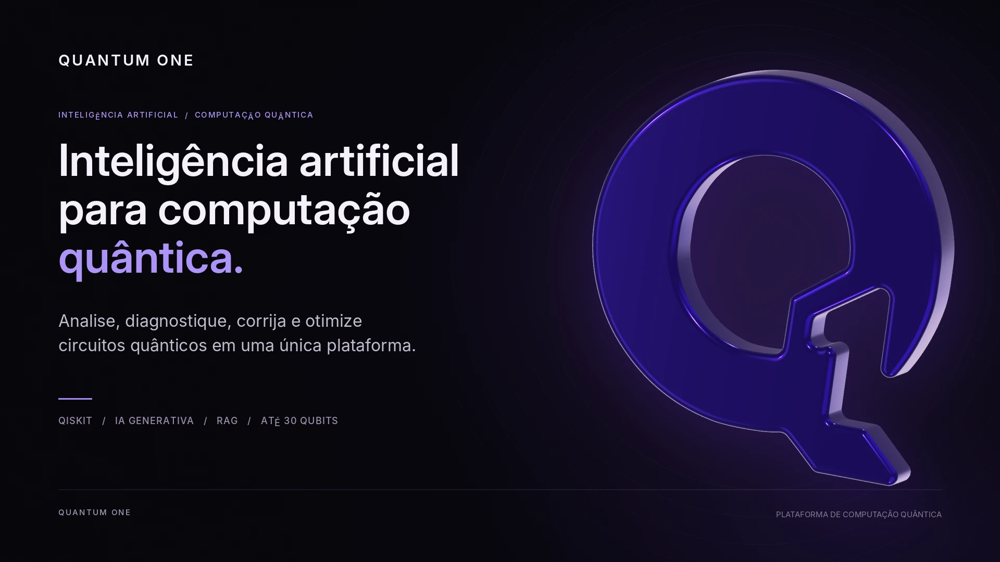
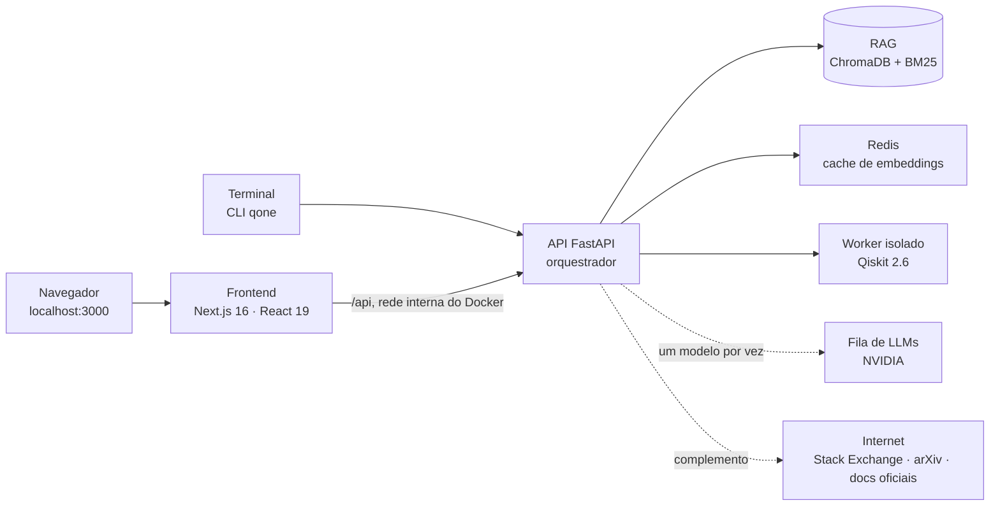

<p align="center">
  
</p>

# QuantumOne

**Inteligência artificial para computação quântica.** Analise, diagnostique, corrija e otimize circuitos
quânticos em uma única plataforma.

`Qiskit 2.6` · `IA generativa` · `RAG` · `até 30 qubits` · `FastAPI` · `Next.js 16` · `Docker`

---

## Sumário

1. [O que é o QuantumOne](#o-que-é-o-quantumone)
2. [O que ele faz](#o-que-ele-faz)
3. [Rodar em uma máquina nova](#rodar-em-uma-máquina-nova)
4. [Como usar](#como-usar)
5. [Explicação técnica](#explicação-técnica)
   - [Arquitetura](#arquitetura)
   - [Fluxo de uma análise](#fluxo-de-uma-análise)
   - [RAG: base de conhecimento e busca](#rag-base-de-conhecimento-e-busca)
   - [Fila de modelos de linguagem](#fila-de-modelos-de-linguagem)
   - [Motor quântico (Qiskit)](#motor-quântico-qiskit)
   - [Resiliência: o programa nunca recusa um pedido](#resiliência-o-programa-nunca-recusa-um-pedido)
   - [Segurança e privacidade](#segurança-e-privacidade)
   - [API](#api)
6. [Configuração](#configuração)
7. [Testes e qualidade](#testes-e-qualidade)
8. [Resultados medidos](#resultados-medidos)
9. [Estrutura do repositório](#estrutura-do-repositório)
10. [Limitações conhecidas](#limitações-conhecidas)
11. [Documentação detalhada](#documentação-detalhada)

---

## O que é o QuantumOne

O QuantumOne é um assistente especializado em computação quântica. Você escreve uma pergunta, cola um
circuito, anexa arquivos ou a pasta inteira de um projeto, em qualquer combinação, e ele devolve uma
análise completa: o que está errado, o código corrigido e validado, o circuito otimizado com métricas e uma
explicação no seu nível de conhecimento, apoiada em documentação confiável.

Ele junta três coisas que normalmente ficam separadas:

- **um motor quântico de verdade** (Qiskit 2.6), que diagnostica, corrige, otimiza e verifica circuitos de
  até 30 qubits sem executar o código do usuário;
- **uma base de conhecimento curada** (documentação oficial e conteúdo interno validado), consultada por
  uma busca híbrida com reordenação;
- **modelos de linguagem** (fila de 7 modelos NVIDIA), que planejam a busca, corrigem código quebrado e
  redigem a resposta.

É útil tanto para quem está começando ("o que é emaranhamento?") quanto para quem já trabalha com o tema
("quanto o roteamento para heavy-hex aumenta a profundidade de um GHZ de 20 qubits?"): a resposta se adapta
ao nível de quem pergunta.

## O que ele faz

| Recurso | Como funciona |
|---|---|
| **Análise unificada** | Uma única chamada aceita texto, código, arquivos soltos e pastas de projeto (até 300 arquivos, 3 MB). |
| **Diagnóstico completo** | Lista todos os erros de uma vez (linha, causa, correção, alternativas, confiança), em OpenQASM 2/3 e Python/Qiskit. |
| **Correção validada** | Correção automática primeiro; se não bastar, a IA corrige e o Qiskit revalida. Só aparece como "validado" o código que carrega. |
| **Otimização verificada** | Vários candidatos por perfil, escolha pela métrica prioritária e verificação de equivalência (exata, aproximada ou amostral). |
| **Respostas no seu nível** | Usa o perfil local (iniciante, intermediário, avançado; estilo direto, didático ou detalhado) ou deduz o nível pela pergunta. |
| **Base local + internet** | Busca primeiro na base curada; complementa com Stack Exchange, arXiv e documentação oficial. As fontes aparecem numa lista ao lado da resposta. |
| **Texto ao vivo** | Um cartão mostra a etapa atual, o modelo consultado ("1/7"), o texto sendo escrito e os tempos. |
| **Nunca recusa** | Falhas da IA, do Qiskit, do tempo ou da conexão viram novas tentativas automáticas, com aviso, nunca uma tela de erro. |
| **Perfil local** | Sem cadastro: na primeira abertura, uma personalização por etapas cria um perfil salvo só no navegador, editável depois. |
| **CLI `qone`** | Chat no terminal sobre os arquivos do seu projeto, com propostas de edição revisadas (diff, aplicar, desfazer). |

---

## Rodar em uma máquina nova

O repositório não traz o `.env`: ele guarda a sua chave de API e fica só na sua máquina, bloqueado pelo
`.gitignore`. Depois de clonar, siga os passos abaixo uma vez.

### 1. Instale os programas

| Programa | Para quê | Obrigatório |
|---|---|---|
| [Docker Desktop](https://www.docker.com/products/docker-desktop/) | Roda a API, o ChromaDB, o Redis e a interface | Sim |
| [Git](https://git-scm.com/) | Clonar o repositório | Sim |
| [GitHub CLI](https://cli.github.com/) (`gh`) ou um token do GitHub | Entrar na conta, pois o repositório é privado | Sim |
| Python 3.10 ou superior | Usar a CLI interativa `qone` | Só para a CLI |

No Windows, o Docker Desktop usa o WSL 2 (o instalador oferece habilitar). Reserve cerca de 10 GB livres para
as imagens e os modelos, e deixe o Docker Desktop aberto. A API usa até 4 GB de memória e 4 CPUs.

### 2. Clone o repositório

A conta precisa ter acesso ao repositório (dona ou colaboradora convidada).

```powershell
gh auth login
gh repo clone vladtairovic/QuantumOne-atual
cd QuantumOne-atual
```

### 3. Crie o `.env` a partir do modelo

```powershell
Copy-Item .env.example .env
```

No Git Bash, Linux ou macOS: `cp .env.example .env`.

Abra o `.env` e preencha a chave da NVIDIA (gratuita, em [build.nvidia.com](https://build.nvidia.com/)):

```text
NVIDIA_API_KEY=sua-chave-aqui
```

- Cada pessoa usa a própria chave. Nunca envie o `.env` por chat, e-mail ou commit.
- Sem chave o projeto também funciona: as respostas viram extrativas (trechos da base local) e a proposta de
  edição da CLI fica indisponível. Diagnóstico e otimização com o Qiskit não dependem da chave.
- Os demais valores do `.env.example` já vêm prontos; mude só se precisar (por exemplo `API_PORT` e
  `FRONTEND_PORT`, se as portas 8000 ou 3000 estiverem ocupadas).

### 4. Suba o projeto

```powershell
docker compose up --build -d --wait
docker compose ps
```

A primeira vez leva de 10 a 20 minutos: o Docker baixa as dependências, o modelo de embeddings e o reranker,
e a API indexa os exemplos e o **conhecimento interno** (`documentos/conhecimento_interno/`). Todos os
serviços devem aparecer como `healthy`.

- Interface: http://localhost:3000
- Documentação da API (Swagger): http://localhost:8000/docs

Para conferir: faça uma pergunta na interface. O cartão ao vivo mostra o modelo consultado e a resposta
termina com "Redigida por …" (com a chave configurada).

### 5. CLI no terminal (opcional)

```powershell
python cli.py --repo . --chat
```

Guia completo, inclusive como instalar o comando `qone`, em [docs/CLI.md](docs/CLI.md).

### Parar e retomar

```powershell
docker compose down
docker compose up -d --wait
```

Não use `down -v`: isso apaga os volumes com a base indexada e os modelos baixados.

### Problemas comuns

| Sintoma | O que fazer |
|---|---|
| `port is already allocated` | Outra aplicação usa a porta 3000 ou 8000: feche-a ou mude `FRONTEND_PORT`/`API_PORT` no `.env`. |
| O Docker não inicia | Habilite o WSL 2 e a virtualização na BIOS; abra o Docker Desktop antes do `docker compose`. |
| Resposta sem "Redigida por" | Chave ausente ou errada no `.env`. Corrija e rode `docker compose up -d --force-recreate api`. |
| A primeira subida demora ou falha no download | Confira a internet e rode `docker compose up --build -d --wait` de novo; o que já foi baixado é reaproveitado. |

---

## Como usar

### Interface (http://localhost:3000)

Escreva o pedido, cole código (OpenQASM 2/3 ou Python/Qiskit, inclusive em blocos ```` ``` ```` dentro da
mensagem), use **Anexar** para arquivos ou **Anexar pasta** para o projeto inteiro e clique em **Analisar**.

- **Ao vivo:** o cartão mostra a etapa ("Qiskit: diagnosticando…", "Planejando a busca: consultando … (1/4)",
  "Redigindo a resposta: consultando … (1/7)"), o texto sendo escrito, os tempos, o histórico e o botão
  "Cancelar análise".
- **Código quebrado:** diagnóstico completo, correção validada pelo Qiskit e explicação de cada erro. Em
  Python legado (Aer, `execute`, `print`), só a construção do circuito é aproveitada; nada é executado.
- **Código válido:** otimização verificada, métricas antes/depois, CX equivalentes, garantia da verificação e
  método de simulação recomendado.
- **Pastas e notebooks:** cada arquivo é classificado (circuito QASM, circuito Python, notebook, documento,
  dados ou ignorado); circuitos são analisados um a um e documentos entram no contexto.
- **Ferramentas:** painéis **Arquivos**, **Diff** (código maior, com copiar nos dois lados), **Qiskit** (prévia
  com todas as operações do circuito) e **Fontes**.
- **Perfil:** criado na primeira abertura e editável em **Meu perfil**; projetos, histórico e preferências
  ficam no navegador (exporte o backup em **Configurações**).

### CLI interativa (`qone`)

```powershell
python cli.py --repo . --chat
```

Conversa com a análise unificada sobre os arquivos do projeto, mostra o modelo consultado ao vivo, propõe
edições com diff conferidas pelo Qiskit (`/propor`, `/aplicar`, `/desfazer`), diagnostica (`/diagnosticar`),
otimiza (`/qiskit`) e guarda o histórico localmente. Para comandos de uma linha em scripts, use
`qone_cli.py` (`saude`, `perguntar`, `analisar`, `diagnosticar`, `otimizar`, `limites`).

---

## Explicação técnica

### Arquitetura



| Componente | Tecnologia | Papel |
|---|---|---|
| Frontend | Next.js 16, React 19, TypeScript, Three.js | Interface com efeito de vidro e profundidade (glassmorphism + spatial UI), Montserrat, animações; cartão ao vivo; perfil local. |
| API | FastAPI, Pydantic 2 (Python 3.12) | Contratos estritos (`extra='forbid'`), OpenAPI gerado e conferido em teste; orquestrador da análise. |
| RAG | ChromaDB, BM25 em memória, sentence-transformers, cross-encoder | Busca híbrida, reordenação, reescrita de consulta, orçamento de contexto e verificação. |
| LLMs | API NVIDIA (compatível com OpenAI), streaming | Planejamento, correção de código, propostas de edição e redação da resposta. |
| Motor quântico | Qiskit 2.6, Qiskit Aer 0.18 | Diagnóstico, correção, otimização e verificação em um subprocesso isolado. |
| Cache | Redis | Vetores de embeddings com expiração de 1 hora (opcional). |
| CLI | Python puro (sem dependências) | Chat no terminal, propostas de edição, histórico em SQLite local. |

### Fluxo de uma análise

`POST /analise` executa, em ordem (`orquestrador.py`):

1. **Interpretação** do envio e classificação dos arquivos.
2. **Diagnóstico** de todos os circuitos no worker do Qiskit (sem IA).
3. **Planejamento** da busca pela fila rápida de modelos (Lightning, Bolt, Laguna, Super): consultas para a
   base e para a internet, a partir do pedido e dos erros encontrados.
4. **Base local e internet em paralelo** às correções (nenhuma das duas usa IA, então a regra de um modelo por
   vez continua valendo).
5. **Correção e otimização** de cada circuito: correção automática conferida pelo Qiskit; se ela não resolver
   tudo sem perda, correção pela IA revalidada pelo Qiskit (até 2 tentativas); depois, otimização verificada.
6. **Redação da resposta** pela fila principal de 7 modelos, em streaming, com o perfil do usuário, os
   resultados do Qiskit, os trechos da base e da internet.
7. **Verificação** da resposta (informativa) e registro da conversa.

Cada etapa e cada modelo consultado são publicados em memória; o frontend lê
`GET /analise/progresso/{id}` a cada 0,5 s. Perguntas fora do domínio, sem código nem arquivos, não chamam a IA.

### RAG: base de conhecimento e busca

- **Base:** catálogo com 308 fontes verificadas (documentação oficial do Qiskit e da IBM, OpenQASM e outras)
  e documentos internos validados, coletados por um processo administrativo com allowlist e robots.txt
  (`python -m rag.sincronizar_conhecimento`). A base não muda durante as consultas.
- **Busca híbrida:** vetorial (`paraphrase-multilingual-MiniLM-L12-v2`, 384 dimensões) + BM25 em memória,
  com tokenização sensível a código e expansão PT→EN de termos técnicos, fundidas por RRF.
- **Camadas ligadas na implantação Docker:**

| Camada | Variável | O que faz |
|---|---|---|
| Reranker | `RAG_RERANKER=1` | Cross-encoder multilíngue `mmarco-mMiniLMv2-L12-H384-v1` reordena os 30 melhores candidatos. |
| Reescrita de consulta | `RAG_CONSULTA=1` | A IA gera variantes da pergunta; as buscas são fundidas (rota `/query`). |
| Orçamento de contexto | `RAG_ORCAMENTO=1` | Distribui o espaço do contexto pela relevância de cada trecho. |
| Verificação | `RAG_VERIFICACAO=1` | Confere frase a frase se a resposta tem apoio nas fontes. Em `/analise` só informa; em `/query` descarta respostas sem apoio. |
| MMR | `RAG_MMR=0` | Diversidade de trechos. **Desligado**: piorou a busca nas medições. |

- **Evidência:** antes de responder, a busca avalia se há evidência suficiente; perguntas fora do domínio são
  recusadas sem chamar a IA. A avaliação usa um gabarito de 240 casos dividido em desenvolvimento e reservado.

### Fila de modelos de linguagem

| Fila | Modelos, em ordem | Uso |
|---|---|---|
| Principal (7) | Nemotron 3 Ultra 550B → Nemotron 3.5 Super VL 120B → Nemotron 3.5 Lightning 30B → Nemotron 3 Nano Omni 30B → Laguna XS 2.1 → Nemotron 3.5 Bolt E4B → Ising Calibration 1.5 31B | Resposta, correção de código, propostas da CLI |
| Rápida (4) | Lightning → Bolt → Laguna → Super | Planejamento da busca e reescrita de consulta |

- **Um modelo de cada vez:** cada modelo tem até **45 s** (`LLM_TIMEOUT_SECONDS`); ao estourar, a requisição é
  cancelada e só então o próximo é chamado.
- **Streaming:** o texto aparece ao vivo; o raciocínio interno dos Nemotron fica desligado para responderem
  direto.
- **Pausas só para erros permanentes:** 401/403/404 pausam o modelo por 1 hora; 429 por 60 s.
- **Nível do usuário:** as instruções calibram profundidade e linguagem (leigo, intermediário, especialista)
  pelo perfil local ou pela pergunta. O texto não traz marcadores de fonte: as fontes ficam na lista ao lado.

### Motor quântico (Qiskit)

- **Diagnóstico:** analisador tolerante de OpenQASM 2 (e subconjunto do 3) e análise estática de Python/Qiskit
  (AST), com regras de migração verificadas contra o Qiskit instalado (APIs removidas no 2.x, como `execute`,
  `Aer.get_backend` e `cnot`).
- **Correção:** reescritas seguras e locais; o código corrigido é sempre revalidado pelo carregador restrito.
- **Otimização:** perfis `rapido`, `balanceado`, `avancado` (padrão) e `experimental`; prioridade por portas de
  dois qubits, profundidade ou total; alvos de hardware (linear, anel, grade, heavy-hex; conjuntos IBM).
- **Verificação graduada:** exata, aproximada, amostral ou estatística; cada resultado informa o método e a
  garantia obtida. Circuitos de até 30 qubits (limite padrão de 32), sem simulação exata universal acima disso.
- **Isolamento:** o código do usuário nunca é executado; a construção do circuito passa por um interpretador
  restrito, num subprocesso descartável com limites de CPU, memória e arquivos.

### Resiliência: o programa nunca recusa um pedido

| Onde falha | O que acontece |
|---|---|
| Os 7 modelos falham | A fila recomeça, com pausas de 5, 10, 20 e 30 s, por até 30 minutos (`LLM_INSISTIR_SEGUNDOS`), avisando ao vivo. Só não insiste com chave inválida (erro permanente). |
| A análise falha ou estoura o tempo | É refeita automaticamente ("refazendo automaticamente (tentativa 2)") enquanto houver tempo no teto de 30 minutos. |
| Worker do Qiskit ocupado ou travado | Repete as falhas passageiras; tempo esgotado, uma vez. |
| Conexão do navegador ou servidor 5xx | A interface tenta de novo sozinha (2, 4, 8, 15 s…), por até 30 minutos. |
| Tempo total esgotado | A resposta é montada com a base, a internet e o Qiskit, ou uma mensagem explica o que houve. Nunca uma tela de erro. |

Erros da própria entrada (por exemplo, um circuito inválido) não são repetidos: são explicados ao usuário.

### Segurança e privacidade

- A chave fica só no `.env` local (fora do Git e das imagens); nunca vai para o navegador.
- A CLI bloqueia o envio de arquivos com credenciais aparentes (chaves NVIDIA, GitHub, Google, senhas).
- Conteúdo de arquivos, da base e da internet é tratado como dado, nunca como instrução para a IA.
- Contêineres sem privilégios extras (`no-new-privileges`, `cap_drop: ALL`, `pids_limit`); ChromaDB e Redis
  sem porta publicada no host; frontend e API ligados só a `127.0.0.1`.
- Com a chave configurada, o pedido, o código enviado e os trechos recuperados vão para a NVIDIA. Para nada
  sair da máquina: `QONE_LLM=local` e `QONE_PESQUISA_WEB=0`.

### API

Documentação interativa em http://localhost:8000/docs (OpenAPI em `openapi.json`).

| Rota | Função |
|---|---|
| `POST /analise` | Análise unificada: texto, código, arquivos e pastas. |
| `GET /analise/progresso/{progress_id}` | Etapa atual, modelo em uso e texto parcial (ao vivo). |
| `POST /assistente/proposta` | Proposta de edição estruturada (usada pela CLI). |
| `POST /qiskit/diagnose` | Diagnóstico completo com correção validada. |
| `POST /qiskit/optimize` | Otimização verificada (`extrair_construcao` para Python de projeto). |
| `GET /qiskit/limits` | Limites do motor de circuitos. |
| `POST /query` | Pergunta direta ao RAG. |
| `POST /search` | Recuperação de trechos sem gerar resposta. |
| `POST /conversations`, `GET /conversations/{id}`, `POST /conversations/{id}/messages` | Conversas com histórico. |
| `GET /documents`, `POST /documents` | Documentos da base. |
| `POST /evaluate` | Registro de avaliação de respostas. |
| `GET /health` | Saúde do serviço. |

---

## Configuração

Os padrões já vêm no `compose.yaml`; o `.env` só precisa da chave. Principais variáveis:

| Variável | Padrão | Efeito |
|---|---|---|
| `NVIDIA_API_KEY` | vazio | Chave da fila de modelos (sem ela, respostas extrativas locais). |
| `NVIDIA_MODELS` / `NVIDIA_MODELS_RAPIDOS` | vazio | Troca a ordem ou a lista da fila principal e da fila rápida. |
| `LLM_TIMEOUT_SECONDS` | `45` | Prazo de cada modelo. |
| `LLM_INSISTIR_SEGUNDOS` | `1800` | Por quanto tempo a fila é percorrida de novo quando todos falham. |
| `LLM_STREAMING` | `1` | Texto ao vivo enquanto o modelo escreve. |
| `QONE_ANALISE_TIMEOUT_SECONDS` | `1800` | Teto da análise (dentro dele, falhas são refeitas). |
| `QONE_PESQUISA_WEB` | `1` | `0` desliga a pesquisa na internet. |
| `QONE_LLM` | `auto` | `local` nunca chama a IA (100% offline). |
| `RAG_RERANKER`, `RAG_CONSULTA`, `RAG_ORCAMENTO`, `RAG_VERIFICACAO`, `RAG_MMR` | `1`, `1`, `1`, `1`, `0` | Camadas do RAG. |
| `API_MEMORY_LIMIT` / `API_CPU_LIMIT` | `4g` / `4` | Recursos da API. |
| `FRONTEND_PORT` / `API_PORT` | `3000` / `8000` | Portas locais. |

Depois de mudar o `.env`: `docker compose up -d --force-recreate api`. Lista completa e comentada no
[.env.example](.env.example) e em [docs/ARQUITETURA.md](docs/ARQUITETURA.md).

---

## Testes e qualidade

| Conjunto | Como rodar |
|---|---|
| Backend (mais de 600 testes) | `docker build --target test -t quantumone-testes .` e `docker run --rm quantumone-testes` (o mesmo passo do GitHub Actions). |
| Integração em contêineres | `python scripts/validar_docker.py` (também no CI). |
| Frontend | `cd frontend`, `npm run lint`, `npm run build`; testes do cliente: `npx tsc services/analysis-api.ts --outDir C:/tmp/analysis-api-test --module commonjs --target es2022 --skipLibCheck` e `node --test tests/analysis-api.test.cjs`. |
| Navegador (Playwright) | `SKIP_LIVE_LLM=1 node scripts/test_frontend.cjs`, com a stack em execução. |
| Avaliação do RAG | `python -m rag.avaliacao_rag --split reservado --saida avaliacao.json` (com `--modos` para comparar camadas). |

O GitHub Actions (`.github/workflows/validar.yml`) roda a suíte de testes e a validação com os contêineres
reais a cada envio para a `main`.

## Resultados medidos

Qualidade da busca no conjunto reservado (86 casos que não foram usados para ajustar nada), K = 5:

| Configuração | Recall@5 | MRR | Acerto no 1º lugar | Perguntas fora do domínio recusadas |
|---|---|---|---|---|
| Busca híbrida, sem camadas | 0,852 | 0,805 | 0,700 | 83% |
| **Híbrida + reranker (implantação)** | **0,887** | **0,885** | **0,825** | **100%** |

O reranker acrescenta cerca de 0,6 s por busca nesta CPU. A redação pela IA costuma levar de 10 a 25 s; uma
análise completa, de 40 s a pouco mais de 1 min. Detalhes, demais camadas e como reproduzir em
[docs/RAG.md](docs/RAG.md) e [docs/BENCHMARKS.md](docs/BENCHMARKS.md).

## Estrutura do repositório

```text
.
├── main.py, orquestrador.py        API FastAPI e orquestrador da análise unificada
├── contratos.py, contratos_analise.py   contratos Pydantic das rotas
├── servicos.py                     inicialização e serviços da API
├── cli.py, qone_core.py, qone_store.py   CLI interativa (qone)
├── qone_cli.py                     CLI de comandos avulsos
├── rag/                            busca, camadas, fila de LLMs, pesquisa na internet, avaliação
├── quantum/                        motor quântico: diagnóstico, correção, otimização, verificação, worker
├── frontend/                       interface Next.js
├── documentos/                     catálogo de fontes e conhecimento interno
├── exemplos/                       circuitos e documentos de exemplo
├── tests/                          testes do backend e da CLI
├── scripts/                        validação Docker, benchmarks e utilitários
├── docs/                           documentação técnica detalhada
├── compose.yaml, Dockerfile        implantação com Docker
└── .env.example                    modelo de configuração (copie para .env)
```

## Limitações conhecidas

- O primeiro modelo da fila (Ultra) costuma passar dos 45 s em respostas longas; nesse caso responde o
  segundo (Super), e a análise leva cerca de 45 s a mais.
- A verificação de respostas usa um limiar ainda não calibrado para texto de IA: em `/analise` ela só informa.
- O tema "medição" fica abaixo da meta de recall no conjunto reservado (0,60 para meta de 0,70).
- O catálogo externo só entra na base após a sincronização administrativa; o PennyLane não é coletado.
- O OpenQASM 3 é convertido para o subconjunto básico; circuitos grandes e muito emaranhados podem ficar sem
  verificação dentro do orçamento (não existe simulação exata universal de 30 qubits: o statevector ocupa 16 GiB).
- A pesquisa na internet usa APIs públicas sem chave: o Stack Exchange limita a cerca de 300 consultas por dia
  (`STACKEXCHANGE_KEY` amplia) e a Wikipedia exige `QONE_WEB_CONTATO`.

## Documentação detalhada

| Documento | Conteúdo |
|---|---|
| [ARQUITETURA.md](docs/ARQUITETURA.md) | Componentes, fluxos, decisões técnicas e todas as variáveis. |
| [RAG.md](docs/RAG.md) | Pipeline de busca, camadas, benchmark e medições. |
| [LLM.md](docs/LLM.md) | Fila de modelos, streaming, nível do usuário e resiliência. |
| [MOTOR-QUANTICO.md](docs/MOTOR-QUANTICO.md) | Diagnóstico, correção, otimização e verificação. |
| [BASE-DE-CONHECIMENTO.md](docs/BASE-DE-CONHECIMENTO.md) | Fontes, curadoria e atualização da base. |
| [CLI.md](docs/CLI.md) | CLI interativa `qone`. |
| [API-DETALHADA.md](docs/API-DETALHADA.md) | Contratos da API. |
| [BENCHMARKS.md](docs/BENCHMARKS.md) | Resultados, problemas resolvidos e limitações. |
| [circuitos-grandes.md](docs/circuitos-grandes.md) | Limites e estratégias para circuitos grandes. |
