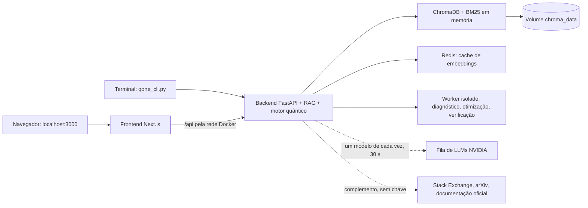

# GrowUp — QuantumOne

O QuantumOne (QOne) é uma plataforma especializada em computação quântica. Uma única análise aceita
**texto, código, arquivos ou a pasta inteira do projeto**, em qualquer combinação. O Qiskit diagnostica,
corrige (com ajuda da LLM, sempre revalidada) e otimiza circuitos de até 30 qubits; a LLM busca primeiro
na base local, complementa com pesquisa na internet sem chave e junta tudo numa resposta com fontes.
Enquanto a análise roda, a interface mostra ao vivo a etapa e o modelo consultado.

| Área | O que mudou | Documento |
|---|---|---|
| Arquitetura | componentes, fluxos, decisões e variáveis | [ARQUITETURA.md](docs/ARQUITETURA.md) |
| Análise unificada | `POST /analise`: texto, código, arquivos e pastas; Qiskit + base + internet + LLM; progresso ao vivo | [ARQUITETURA.md](docs/ARQUITETURA.md#análise-unificada-post-analise) |
| Base de conhecimento | catálogo com 308 fontes verificadas + 11 documentos internos validados | [BASE-DE-CONHECIMENTO.md](docs/BASE-DE-CONHECIMENTO.md) |
| RAG | busca híbrida (vetorial + BM25 + PT→EN), verificação de evidência, avaliação com métricas | [RAG.md](docs/RAG.md) |
| Diagnóstico e motor | todos os erros de uma vez, correções validadas, perfis, verificação até 30 qubits | [MOTOR-QUANTICO.md](docs/MOTOR-QUANTICO.md) |
| Resultados | benchmarks contra a linha de base, problemas resolvidos e limitações | [BENCHMARKS.md](docs/BENCHMARKS.md) |
| Geração de respostas | fila de 7 modelos NVIDIA, um de cada vez, 30 s por modelo, streaming, fallback local | [LLM.md](docs/LLM.md) |

## Iniciar e abrir

Abra PowerShell nesta pasta:

```powershell
docker compose up --build -d --wait
docker compose ps
```

Frontend: http://localhost:3000

Swagger da API: http://localhost:8000/docs

O primeiro build baixa dependências e o modelo de embeddings. Na inicialização, a API indexa os
exemplos iniciais e o **conhecimento interno** (`documentos/conhecimento_interno/`). Durante a análise,
a internet só é usada para a fila de LLMs e para a pesquisa complementar (desligável na interface ou com
`QONE_PESQUISA_WEB=0`); a base local não é alterada por ela.

A atualização da documentação externa é um **processo administrativo separado**, manual ou em lote,
sem API de busca (detalhes em [BASE-DE-CONHECIMENTO.md](docs/BASE-DE-CONHECIMENTO.md#como-atualizar-processo-administrativo-fora-das-consultas)):

```powershell
docker compose exec api python -m rag.sincronizar_conhecimento
docker compose exec api python -m rag.sincronizar_conhecimento --status
```

## Organização



- Frontend: porta 3000; chamadas pela mesma origem, encaminhadas à API interna.
- API: porta local 8000. Os contratos anteriores foram preservados (`web_search` ainda é aceito, mas é ignorado e gera aviso).
- ChromaDB: coleção única `qiskit_documentacao_multilingue`, sem porta publicada no host. Modelo `sentence-transformers/paraphrase-multilingual-MiniLM-L12-v2`, normalizado, 384 dimensões.
- Redis: só na rede interna; cache de vetores com expiração de 1 hora. Se cair, os embeddings são calculados normalmente.
- Volumes `chroma_data`, `model_cache` e `api_data` preservam banco, modelo, avaliações e snapshots.

## Usar a interface

Escreva o pedido, cole código (OpenQASM 2/3 ou Python/Qiskit, inclusive dentro da mensagem em blocos
```` ``` ````), use **Anexar** para arquivos ou **Anexar pasta** para o projeto inteiro (até 300 arquivos,
3 MB) e clique em Analisar. Pode enviar só uma dessas coisas ou todas juntas.
- **Ao vivo**: enquanto a análise roda, um cartão mostra a etapa atual (“Qiskit: diagnosticando…”,
  “Pesquisando na internet…”), o **modelo em uso** (“consultando nvidia/nemotron-3-ultra-550b-a55b (1/7)”),
  o texto que o modelo já escreveu (“Escrevendo agora”), os tempos e o histórico, com o botão
  “Cancelar análise”.
- **Código quebrado**: o Qiskit lista todos os problemas; a correção determinística é tentada primeiro e,
  se não bastar, a LLM corrige e o Qiskit revalida (o código só aparece como “validado” se carregar).
  Em Python legado (Aer, `execute`, `print`), só a construção do circuito é aproveitada; nada é executado.
- **Pastas e notebooks**: cada arquivo é classificado (circuito QASM, circuito Python, notebook,
  documento, dados ou ignorado); circuitos são analisados um a um e documentos entram no contexto.
- **Código válido**: otimização pelo perfil escolhido (Rápida, Balanceada, Avançada, Experimental), relatório antes/depois, CX equivalentes, método e garantia da verificação, método de simulação recomendado e compromissos entre métricas.
- **Código inválido**: em vez de parar no primeiro erro, a interface mostra o diagnóstico completo (linha, causa, correção, alternativas, confiança) e o código corrigido validado.
- **Pergunta**: a LLM planeja as consultas, busca primeiro na base local [Fonte N], complementa com a internet [Web N] (caixa “Pesquisar também na internet”) e cita as duas. Sem chave, ou se nenhum modelo responder, a resposta é **extrativa local** e identificada como tal.
- **Fontes**: caixa compacta "Fontes consultadas (N)", recolhida por padrão, com selo “base local” ou “internet”.

Os painéis **Arquivos**, **Diff**, **Qiskit** e **Fontes** continuam disponíveis. A ferramenta Terminal
foi removida da interface; o terminal agora é o CLI abaixo.

## CLI

```powershell
python qone_cli.py saude
python qone_cli.py analisar "Corrija e otimize meu projeto" --anexo C:\caminho\do\projeto
python qone_cli.py analisar "Por que dá erro?" --codigo circuito.qasm --sem-web
python qone_cli.py perguntar "Como medir todos os qubits?"
python qone_cli.py diagnosticar exemplos\circuito_validado_10q.qasm
python qone_cli.py otimizar circuito.qasm --perfil avancado --topologia heavy_hex --portas ibm_heron
```

A URL vem de `--api` ou de `QONE_API_URL` (padrão `http://127.0.0.1:8000`). O CLI usa as mesmas rotas
do Desktop Chat, e nenhum código é executado localmente. `analisar` mostra no terminal, ao vivo, cada
etapa e o modelo consultado; pastas são lidas recursivamente (sem `.git`, `node_modules`, `.venv`).

## Contas e e-mail

O cadastro e a alteração de senha usam a API. As credenciais ficam no volume `api_data`. Projetos, histórico, foto e preferências pertencem ao workspace deste navegador. Exporte o backup em **Configurações** para levá-lo a outro navegador.

No Compose local, o Mailpit recebe os códigos de confirmação. [Abrir a caixa de testes](http://localhost:8025). Para entrega em caixas reais, configure `SMTP_HOST`, `SMTP_PORT`, `SMTP_STARTTLS=1`, `SMTP_FROM`, `SMTP_USER` e `SMTP_PASSWORD` no ambiente da API.

## Credencial e modelo

A credencial fica somente no `.env` local, ignorado pelo Git e pelos builds. Nunca use chave em variáveis `NEXT_PUBLIC` ou no navegador. Copie `.env.example` para `.env`; as chaves são **opcionais**. Com `NVIDIA_API_KEY`, a resposta é redigida pela fila de modelos NVIDIA ([LLM.md](docs/LLM.md)); sem ela, a resposta é extrativa local.

- Sem chave: `/query` responde de forma extrativa com a base local (`answer_mode: "local"`).
- `QONE_LLM=local`: nunca chama a LLM, mesmo com chave (100% offline).
- `QONE_LOCAL_FALLBACK=0`: restaura o comportamento antigo (503 `LLM_NOT_CONFIGURED`).
- Com chave, o pedido, o código enviado e os trechos (base e internet) vão para a NVIDIA.
- `QONE_PESQUISA_WEB=0`: desliga a pesquisa na internet. `QONE_WEB_CONTATO` (um e-mail ou URL seu) habilita a Wikipedia, cuja política exige contato no User-Agent; `STACKEXCHANGE_KEY` (gratuita) amplia o limite de ~300 consultas/dia do Stack Exchange.

Após mudar `.env`: `docker compose up -d --force-recreate api`.

## Parar e retomar

```powershell
docker compose down
docker compose up -d --wait
```

Não use `down -v`, para preservar os dados.

## Testes e evidências

- Backend: `docker build --target test -t growup-api-tests .` e `docker run --rm growup-api-tests` (é o mesmo passo do GitHub Actions).
- Benchmarks e avaliação do RAG: comandos em [BENCHMARKS.md](docs/BENCHMARKS.md#como-reproduzir).
- Integração real em containers: `python scripts/validar_docker.py` (também no CI).
- Navegador: `SKIP_LIVE_LLM=1 node scripts/test_frontend.cjs` (requer Playwright e a stack em execução).
- Frontend: `cd frontend`, `npm run lint`, `npm run build`, compilar o cliente com `npx tsc services/analysis-api.ts --outDir C:/tmp/analysis-api-test --module commonjs --target es2022 --skipLibCheck` e rodar `node --test tests/analysis-api.test.cjs`.

## Circuitos grandes e limites

Os padrões são 2.500 linhas, 32 qubits, 10.000 operações, profundidade 10.000, 512 KiB de código e 60
segundos por análise (`GET /qiskit/limits`). Não existe simulação exata universal de 30 qubits (o
statevector ocupa 16 GiB). O motor escolhe o método de verificação e de simulação pela estrutura do
circuito e diz qual garantia obteve. Detalhes em [MOTOR-QUANTICO.md](docs/MOTOR-QUANTICO.md) e
[circuitos-grandes.md](docs/circuitos-grandes.md).

## Limitações

Ver [BENCHMARKS.md](docs/BENCHMARKS.md#limitações-conhecidas). Em resumo: o catálogo externo só entra
na base após a sincronização administrativa; o PennyLane não é coletado (o site bloqueia coletores); a
resposta local é extrativa; o OpenQASM 3 é convertido no subconjunto básico; circuitos grandes e muito
emaranhados podem ficar sem verificação dentro do orçamento. Cada modelo tem até 30 s; nas medições, uma
análise completa (correção, otimização, base, internet e resposta) levou de 15 a 20 s, com o texto aparecendo
ao vivo enquanto o modelo escreve.
