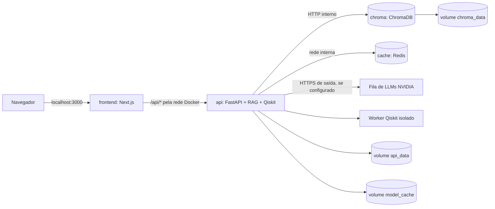

# Guia do GrowUp QuantumOne

Material de estudo e apresentação do projeto, organizado por arquitetura, pastas, API e perguntas que um mentor pode fazer. Confira o estado atual do código antes de apresentar detalhes que possam mudar, como versões de dependências e tamanho da coleção documental.

## 1. O que o projeto faz

O GrowUp QuantumOne é uma aplicação web para estudar e trabalhar com circuitos quânticos usando Qiskit. A pessoa pode enviar um circuito em OpenQASM 2 ou um subconjunto seguro de Python/Qiskit para receber validação, métricas e uma proposta transpilada. Também pode fazer perguntas em linguagem natural: o backend busca trechos da documentação indexada e, quando configurado, usa a fila de LLMs NVIDIA para produzir uma resposta fundamentada (sem chave, a resposta é extrativa local). Há ainda endpoints para buscar documentos, enviar arquivos e registrar avaliações.

São dois caminhos relacionados, mas diferentes:

1. **Análise determinística de circuito:** Qiskit lê e transpila o circuito. Esta operação não precisa de chave de LLM.
2. **Pergunta documental:** Chroma e BM25 recuperam trechos; a fila de LLMs NVIDIA formula a resposta. Sem chave, a resposta é extrativa local (trechos literais com citações).

## 2. Frameworks e tecnologias

| Parte | Tecnologia | Responsabilidade |
|---|---|---|
| Interface | Next.js 16, React 19 e TypeScript | Interface web, componentes e chamadas de API |
| Editor | CodeMirror, por meio de `@uiw/react-codemirror` | Edição do código QASM/Python |
| API | Python, FastAPI e Pydantic 2 | Rotas HTTP, validação e contratos JSON |
| Circuitos | Qiskit 2.6 | Leitura, validação, transpilação e métricas |
| Isolamento do otimizador | Subprocesso Python limitado | Executa Qiskit separadamente, com prazo e recursos definidos |
| RAG | Sentence Transformers, Transformers e PyTorch CPU | Converte texto em embeddings para busca semântica |
| Banco vetorial | ChromaDB Client 1.5.9 e servidor Chroma | Guarda documentos, trechos e metadados pesquisáveis |
| Cache | Redis 7.4 | Mantém embeddings temporários; não é a base documental |
| LLM | Fila de modelos NVIDIA (API compatível com OpenAI) | Redige respostas a partir dos trechos locais; sem busca web |
| Orquestração local | Docker Compose | Constrói, conecta, inicia e monitora os quatro serviços |
| Testes | pytest, Node.js Test Runner e scripts de integração | Verificam contratos, parsers e integração do frontend |

## 3. Arquitetura e Docker Compose



O `compose.yaml` define quatro serviços:

| Serviço | O que faz | Rede e portas | Persistência/saúde |
|---|---|---|---|
| `frontend` | Serve o aplicativo Next.js | Porta do host `3000` (configurável), vinculada a `127.0.0.1`; rede `saida` | Healthcheck faz GET à página inicial. Espera a API ficar saudável. |
| `api` | API, RAG, gerenciamento documental e rotas Qiskit | Porta `8000` do host vinculada a `127.0.0.1`; redes `banco` e `saida` | Limites de CPU/memória/processos; volumes de modelo e dados; healthcheck em `/health`. |
| `chroma` | Banco vetorial permanente | Somente rede `banco`, sem porta publicada no host | Volume `chroma_data` montado em `/data`. |
| `cache` | Redis para embeddings temporários | Somente rede `banco`, sem porta publicada | Política LRU, teto de 128 MB, sem snapshots nem AOF; healthcheck com `redis-cli ping`. Reinício limpa o cache. |

`banco` é uma rede interna, sem acesso direto à internet. `saida` permite ao frontend falar com a API e à API acessar serviços externos. Somente frontend e API publicam portas no host, restritas ao localhost. Chroma e Redis permanecem privados dentro do Compose.

Volumes nomeados:

- `chroma_data`: coleção documental persistente.
- `model_cache`: modelo de embeddings baixado, evitando novo download em cada recriação.
- `api_data`: snapshots coletados, avaliações e demais dados em `/app/data`.

O worker de circuitos não é um quinto serviço permanente: é um subprocesso criado pela API por análise, com ambiente reduzido, concorrência limitada e encerramento em timeout ou desconexão.

Comandos de operação:

```powershell
docker compose up --build -d --wait
docker compose ps
docker compose logs -f api
docker compose exec api python -m rag.sincronizar_conhecimento --status
docker compose down
```

`docker compose down -v` também apagaria volumes nomeados; use apenas quando a intenção for remover dados persistentes.

## 4. Estrutura do repositório

```text
.
├── main.py, servicos.py, contratos.py
├── quantum/                 # API e processamento de circuitos
├── rag/                     # Chroma, embeddings, busca, fila de LLMs e ingestão
├── frontend/                # App Next.js
├── documentos/              # Catálogo, uploads iniciais e base-fonte
├── exemplos/                # Exemplos de consulta, avaliação e circuitos
├── prompts/                 # Prompts versionados para LLM
├── tests/                   # Testes Python e casos de avaliação
├── scripts/                 # Testes e validação Docker/HTTP
├── docs/                    # Contratos operacionais e material técnico
├── compose.yaml             # Orquestra os quatro serviços
├── Dockerfile               # Imagens Python de teste e produção
├── requirements*.txt        # Dependências Python
├── openapi.json             # OpenAPI exportado
├── exportar_openapi.py      # Atualiza o OpenAPI a partir da aplicação
└── .env.example             # Exemplo de configuração, sem segredos
```

## 5. O que cada arquivo e pasta faz

### Arquivos da raiz

| Caminho | Função |
|---|---|
| `main.py` | Cria a aplicação FastAPI, inicia os serviços, define rotas gerais e de conversa, configura middleware, timeout e handlers de erro. Registra também o router de Qiskit. |
| `servicos.py` | Camada de aplicação para inicialização, Chroma, embeddings, RAG e operações de documentos. Traduz exceções internas para erros de serviço. |
| `contratos.py` | Modelos Pydantic da entrada/saída da API: consultas, busca, fontes, saúde, documentos, avaliações e erros. Não implementa acesso ao banco nem análise Qiskit. |
| `compose.yaml` | Define frontend, API, Chroma, Redis, redes, volumes, portas, dependências e healthchecks. |
| `Dockerfile` | Constrói a imagem Python em estágios `core`, `test` e `runtime`; instala dependências, inclui o código e roda Uvicorn como usuário sem privilégios. |
| `requirements-api.txt` | Dependências mínimas da API. |
| `requirements.txt` | Dependências de runtime, incluindo Sentence Transformers, PyTorch CPU, Chroma client, Qiskit e qiskit-aer. |
| `requirements-testes.txt` | Dependências usadas para testes, complementando as da API. |
| `.env.example` | Modelo de configuração local. O arquivo `.env` real contém credenciais e não deve ser versionado. |
| `openapi.json` | Especificação OpenAPI exportada para inspeção ou clientes. |
| `exportar_openapi.py` | Exporta o esquema OpenAPI gerado pela aplicação. |
| `pytest.ini` | Configuração do pytest e marcador para testes live opcionais. |
| `.dockerignore` / `.gitignore` | Excluem do contexto Docker/Git itens locais, caches, segredos, bancos e artefatos. |
| `README.md` | Instruções gerais, configuração, funcionamento e limitações do projeto. |

### `quantum/`

| Caminho | Função |
|---|---|
| `api.py` | Define `GET /qiskit/limits` e `POST /qiskit/optimize`; valida o formato de entrada, limita concorrência e delega a análise ao subprocesso. |
| `qiskit_service.py` | Lê QASM2, chama o interpretador Python permitido, valida limites, transpila e calcula métricas/comparação. |
| `python_parser.py` | Interpreta uma lista explícita de construções Python por AST. Não usa `exec` e não executa imports/código Python arbitrário. |
| `config.py` | Lê os limites configuráveis de código, linhas, qubits, portas, profundidade, tempo e recursos. |
| `errors.py` | Define erros de domínio tipados e a função para aplicar limites. |
| `worker.py` | Ponto de entrada do subprocesso: recebe JSON, executa análise e devolve JSON isolando a falha do worker. |
| `http.py` | Middleware e tratamento de tamanho/erros do corpo HTTP da API de circuitos. |
| `__init__.py` | Marca o pacote Python `quantum`. |

### `rag/`

| Caminho | Função |
|---|---|
| `banco.py` | Configura o cliente/coleção remota Chroma e verifica compatibilidade da coleção. |
| `configuracao.py` | Carrega o modelo de embeddings, gera vetores normalizados e aplica cache Redis. |
| `cache.py` | Cache temporário de vetores por hash de modelo/texto, com TTL. |
| `busca_chromadb.py` | Consulta vetorial e reúne trechos/documentos da coleção para o RAG. |
| `documentos.py` | Faz ingestão, listagem, identificação idempotente de uploads e carregamento dos uploads iniciais. |
| `preparar_chunks.py` | Divide documentos em trechos compatíveis com o tokenizador e gera os metadados de cada trecho. |
| `indexar_documentos.py` | Valida lotes e grava/atualiza os chunks de um documento no Chroma. |
| `coleta_web.py` | Coleta páginas permitidas do domínio IBM, respeita robots.txt, valida redirects e aplica limites HTTP. |
| `sincronizar_conhecimento.py` | Atualiza o catálogo em segundo plano, mantém snapshots, status, trava de execução e reindexação offline. |
| `pipeline.py` | Coordena recuperação local, verificação de evidência, montagem de contexto e chamada à fila de LLMs (ou resposta local). |
| `contexto.py` | Prepara e limita (6.000 caracteres) o contexto documental enviado à LLM. |
| `prompts.py` | Instruções enviadas à LLM (citar fontes, separar inferência, cuidar de versões). |
| `cliente_llm.py` | Fila de prioridade NVIDIA: 7 modelos, 15 s por modelo, disjuntor e teto total. |
| `conversas.py` | Persiste histórico de chat em SQLite, com versão para evitar sobrescrita concorrente e limites de tamanho. |
| `__init__.py` | Marca o pacote Python `rag`. |

### `frontend/`

| Caminho | Função |
|---|---|
| `package.json` / `package-lock.json` | Scripts, dependências JavaScript e versões travadas. |
| `Dockerfile` | Instala pacotes com `npm ci`, cria build Next.js standalone e executa como usuário Node. |
| `next.config.ts` | Configura build standalone, timeout do proxy e reescrita de `/api/*` para `api:8000`. |
| `tsconfig.json` | Opções de compilação TypeScript. |
| `eslint.config.mjs` | Configuração de lint. |
| `app/page.tsx` | Página principal da aplicação. |
| `app/layout.tsx` | Layout HTML global, metadados e estilos compartilhados. |
| `app/globals.css`, `app/integration.css` | Estilos globais e da interface integrada. |
| `services/analysis-api.ts` | Cliente HTTP tipado: consulta limites, abre conversa, envia mensagem e chama o otimizador. |
| `components/analysis/AnalysisForm.tsx` | Estado do editor/chat, seleção de formato, histórico local e orquestração do fluxo de análise. |
| `components/analysis/CodeEditor.tsx` | Editor CodeMirror, com realce simples para QASM2. |
| `components/analysis/SettingsPanel.tsx` | Configurações expostas da recuperação e da consulta. |
| `components/analysis/ResultsView.tsx` | Resposta, métricas Qiskit, fontes e proposta otimizada. |
| `components/analysis/SourceDrawer.tsx` | Painel para inspecionar fontes citadas. |
| `components/analysis/LoadingView.tsx` | Estado visual de processamento. |
| `components/analysis/AnalysisFeedback.tsx` | Mensagens de validação, erro e feedback. |
| `tests/analysis-api.test.cjs` | Testes do cliente API frontend em Node. |
| `public/` | Logo e recursos estáticos. |
| `README.md`, `AGENTS.md` | Orientações locais da aplicação frontend e instruções ao agente de código. |

### Dados, documentação e validação

| Caminho | Função |
|---|---|
| `documentos/fontes_conhecimento.json` | Catálogo de URLs oficiais IBM usadas na coleta automatizada. |
| `documentos/uploads_iniciais.json` | Chunks dos dois documentos de exemplo incluídos na inicialização. |
| `documentos/base_documental.json` | Base-fonte documental usada por tarefas de indexação/validação existentes. |
| `exemplos/*.json` | Payloads de exemplo para consulta, busca e avaliação. |
| `exemplos/documento.txt` | Exemplo de texto para upload/teste. |
| `exemplos/circuito_validado_10q.qasm`, `circuito_validado_6q.py` | Circuitos aceitos pelo fluxo implementado. |
| `prompts/system_prompt_v1.md` | Instruções de sistema do fluxo RAG. |
| `prompts/optimization_prompt_v1.md` | Instruções de otimização para o fluxo LLM, quando usado. |
| `scripts/validar_docker.py` | Validação integrada com serviços e persistência Docker. |
| `scripts/verificar_circuitos_http.py` | Smoke tests HTTP de circuitos contra uma API ativa. |
| `scripts/test_frontend.cjs` | Roteiro de ponta a ponta no navegador. |
| `tests/` | Testes de contratos, API, conversas, cache, ingestão, segurança do parser e capacidade Qiskit. `test_live.py` depende de uma API real configurada. |
| `docs/` | Contratos detalhados, decisões de segurança, operação, validações e histórico de problemas. |

## 6. Fluxo de uma análise de circuito

1. A pessoa escolhe Python/Qiskit ou OpenQASM 2 e envia o código no frontend.
2. O frontend consulta `GET /qiskit/limits`, define o prazo visual e envia `POST /qiskit/optimize`.
3. FastAPI/Pydantic valida o corpo e `quantum.config` verifica bytes e linhas.
4. `quantum.api` limita a concorrência e inicia `python -m quantum.worker` como subprocesso.
5. Para QASM, Qiskit faz o parsing. Para Python, `python_parser.py` percorre a AST e aceita apenas construções permitidas.
6. O serviço valida os limites estruturais, transpila no nível solicitado e calcula operações, profundidade, saída OpenQASM 2 e status de equivalência quando couber no orçamento.
7. O worker devolve JSON; a API transforma erros em respostas com código, linha e detalhes. Timeout, desconexão, excesso de concorrência ou memória também têm erros tipados.
8. O frontend apresenta métricas e proposta. A proposta não altera o editor até a pessoa aprovar/aplicar na interface.

Transpilação pode aumentar o número de portas: ela converte para um conjunto e uma representação adequados ao destino configurado, não promete reduzir cada circuito. A equivalência matricial também pode ser omitida para circuitos acima dos limites de verificação ou com medições/controle clássico.

## 7. Fluxo RAG e documentos

1. Um texto de pergunta vira embedding com o modelo multilíngue local.
2. O embedding busca trechos próximos no Chroma; Redis pode evitar recalcular o vetor.
3. A aplicação monta contexto limitado com trechos e metadados/fonte.
4. Se a chave NVIDIA estiver configurada, o contexto e a pergunta são enviados à fila de modelos; senão, a resposta é extrativa local.
5. A API devolve texto, fontes, estado de evidência, alertas e ID de solicitação. Busca web, se ativada, é uma capacidade separada e seus resultados não são armazenados na coleção.

O catálogo de conhecimento é atualizado pelo sincronizador a partir de páginas permitidas da IBM. O processo registra `status.json` e snapshots no volume `api_data`. Uploads são indexados na coleção compartilhada; Redis não guarda a base.

## 8. API HTTP

### Convenções

- URL local Swagger: `http://localhost:8000/docs`; esquema JSON: `http://localhost:8000/openapi.json`.
- JSON é validado por Pydantic; campos desconhecidos são rejeitados nos contratos que herdam de `Modelo`.
- As respostas de API incluem `mode` (`integrated` ou `demo`) quando definido pelo endpoint e `request_id` para rastreamento.
- Formato geral de erro: `request_id`, `code`, `message` e `fields`. O otimizador usa ainda um objeto `error` com `code`, `message` e `details`.
- HTTP 422 normalmente indica formato/código que falhou validação; 413 significa limite; 429 otimizador ocupado; 503 dependência indisponível; 504 prazo excedido.

### Rotas

| Método e rota | Uso | Entrada e saída |
|---|---|---|
| `GET /health` | Liveness: confirma que o processo responde. Não prova que a LLM, o Chroma e toda dependência externa estão disponíveis. | Resposta de saúde e modo. |
| `POST /query` | Recupera contexto e pergunta à LLM; busca web pode ser configurada por requisição. | `input`, `top_k` (1–10, padrão 3), `web_search` (opcional). Devolve `response`, `sources`, `status`, alertas e estado web. |
| `POST /search` | Busca somente trechos no Chroma, sem gerar resposta de LLM. | `query` e `top_k`; devolve `chunks`, `citations` e `status`. |
| `POST /documents` | Envia documento textual e indexa seus chunks. | Multipart `file`; extensões permitidas `.txt`, `.md`, `.py`, `.qasm`; tamanho máximo 256 KiB; UTF-8. Resposta 201 com ID e nome. |
| `GET /documents` | Lista IDs e nomes encontrados na coleção documental. | Lista `documents` e modo. |
| `POST /evaluate` | Grava avaliação humana em JSONL e calcula aprovação. | Cinco critérios únicos, cada nota de 0 a 5 e evidência. Devolve média, aprovação e sinalização crítica. |
| `GET /qiskit/limits` | Mostra limites efetivos do otimizador. | Sem corpo. |
| `POST /qiskit/optimize` | Valida/transpila circuito deterministicamente. | Exatamente um entre `qasm` legado ou `code`; `format` (`auto`, `qasm`, `python`), nível 0–3. Devolve métricas, circuito QASM, warnings e estado de equivalência. |
| `POST /conversations` | Cria uma conversa persistida para a interface. | Sem corpo; devolve `conversation_id`. |
| `GET /conversations/{conversation_id}` | Lê histórico de conversa. | UUID no caminho; devolve mensagens. |
| `POST /conversations/{conversation_id}/messages` | Acrescenta turno com recuperação/LLM usando o histórico permitido. | Campos de `/query` mais `message_id` UUID idempotente; devolve resposta e fontes. |

### Exemplo de consulta documental

```http
POST /search
Content-Type: application/json
```

```json
{"query":"Como medir qubits no Qiskit?","top_k":5}
```

### Exemplo de pergunta com LLM

```json
{"input":"Explique a medição em Qiskit.","top_k":5,"web_search":false}
```

`web_search` é obsoleto e ignorado (não há busca web). A chave NVIDIA fica só no backend. Perguntas e trechos enviados à NVIDIA saem do ambiente local; nunca coloque a chave em código cliente ou variável `NEXT_PUBLIC_*`.

### Exemplo de otimização QASM2

```json
{"code":"OPENQASM 2.0;\ninclude \"qelib1.inc\";\nqreg q[2];\nh q[0];","format":"qasm","optimization_level":3}
```

### Exemplo de otimização Python

```json
{"code":"from qiskit import QuantumCircuit\nqc = QuantumCircuit(2)\nqc.h(0)","format":"python","optimization_level":3}
```

O interpretador Python aceita somente um subconjunto documentado para construir circuito. Não executa scripts arbitrários, `print`, acesso a arquivos/rede ou imports irrestritos. Parâmetros simbólicos `Parameter` não são atualmente suportados pelo analisador; ângulos devem ser numéricos. Isso é uma escolha de escopo/segurança, não sintaxe geral inválida do Qiskit.

### Limites usuais

Os defaults incluem 2.500 linhas, 512 KiB, 32 qubits, 256 bits clássicos, 10.000 operações, profundidade 10.000, 60 segundos por otimização e uma otimização simultânea. `GET /qiskit/limits` é a referência para o ambiente em execução. `.env.example` lista os parâmetros ajustáveis. Há ainda orçamento para equivalência matricial; não confundir ausência de prova com prova de não equivalência.

## 9. Configuração e segredos

1. Copie `.env.example` para `.env` local.
2. Preencha `NVIDIA_API_KEY` somente se quiser respostas redigidas por LLM.
3. Ajuste portas, limites de circuitos, modelo e sincronização conforme o ambiente.
4. Recrie os serviços necessários após mudanças.

`.env` é ignorado por Git e Docker. A autenticação da API não está implementada; atualmente as portas publicadas ficam restritas ao localhost. Uma publicação pública precisa adicionar autenticação, HTTPS e configuração de rede próprias.

## 10. Perguntas prováveis do mentor

### Arquitetura e escolhas

**Por que separar frontend, API, banco vetorial e cache?**  
Cada serviço tem uma função e ciclo de vida próprios. Chroma guarda documentos persistentes; Redis acelera embeddings e pode ser perdido sem perder a coleção.

**Por que usar FastAPI e Pydantic?**  
FastAPI entrega rotas HTTP, validação integrada e OpenAPI; Pydantic declara tipos, limites e forma das mensagens de entrada e saída.

**O que significa RAG?**  
Retrieval-Augmented Generation: recuperar conteúdo documental relevante antes de pedir à LLM que responda. A resposta deve estar ligada às fontes recuperadas, e contexto insuficiente deve ser exposto.

**Por que embeddings multilíngues?**  
Para representar consulta e documentação como vetores e recuperar conteúdo por similaridade sem depender apenas das mesmas palavras. Um modelo multilíngue também é adequado para perguntas em português e fontes majoritariamente em inglês.

**Redis é o banco principal?**  
Não. É cache temporário com TTL e limite de memória. O Chroma mantém os vetores/documentos e seu volume é persistente.

### Docker e operação

**Por que o Chroma e o Redis não têm portas públicas?**  
Só a API precisa acessá-los. Mantê-los em rede interna reduz a superfície exposta no host.

**O que acontece ao recriar os containers?**  
As imagens/containers podem ser substituídos; os volumes nomeados preservam coleção, modelo baixado e dados da API. Redis é cache efêmero.

**Qual a diferença entre `healthcheck` e `depends_on`?**  
O healthcheck sinaliza se um serviço responde a uma verificação. `depends_on` ordena inicialização e pode aguardar condição saudável, mas não torna dependências externas infalíveis.

**Como os serviços acessam uns aos outros?**  
Pelo DNS interno do Compose, usando nomes como `api`, `chroma` e `cache`, e suas portas de container. A porta `localhost` é para acesso no host.

### API e segurança

**Como a API identifica uma requisição?**  
Gera um `request_id`, devolvido ao cliente e incluído nos logs, para relacionar erro e solicitação sem registrar o circuito completo.

**Por que executar Qiskit em subprocesso?**  
Para isolar uso de CPU/memória e poder encerrar a análise em timeout ou desconexão, reduzindo o efeito de falhas do processamento sobre o servidor HTTP.

**O Python enviado é executado?**  
Não como script Python livre. A AST é percorrida por interpretador próprio que aceita instruções, construtores e portas explicitamente permitidos.

**O que distingue erro 422, 413, 429 e 504?**  
422 indica entrada ou circuito inválido/não suportado; 413 limite de tamanho/capacidade; 429 concorrência ocupada; 504 prazo esgotado.

**A API é segura para publicar na internet?**  
O Compose local restringe portas ao loopback, mas o produto não possui autenticação da API. Publicação externa requer autenticação, HTTPS, revisão dos limites e configuração de rede.

**A chave da LLM é enviada ao navegador?**  
Não. É uma variável do serviço API em `.env`. As perguntas e trechos de contexto são enviados à NVIDIA quando a LLM é usada, então isso precisa estar claro para a equipe e usuários.

### Qiskit e qualidade

**A transpilação sempre reduz portas ou profundidade?**  
Não. Ela reescreve o circuito para o conjunto de portas alvo e o nível escolhido; algumas decomposições podem aumentar a contagem.

**`equivalente: null` quer dizer que os circuitos são diferentes?**  
Não. Quer dizer que a verificação não foi realizada, por exemplo porque excedeu o orçamento ou porque o circuito inclui medições/controle que não permitem aquela comparação unitária direta.

**O analisador aceita todo código Python/Qiskit?**  
Não. Aceita um subconjunto restrito voltado a construir circuitos. Simulação, visualização, operações arbitrárias e `Parameter` simbólico ficam fora do escopo atual.

**Como evitar ultrapassar limites configurados?**  
Consultar `GET /qiskit/limits`, validar a entrada antes do worker e usar limites independentes de linhas, bytes, qubits, operações, profundidade, tempo, memória e concorrência.

### RAG e limitações

**O que ocorre sem `NVIDIA_API_KEY`?**  
`/query` responde de forma extrativa com a base local (`answer_mode: "local"`); com `QONE_LOCAL_FALLBACK=0`, devolve 503.

**Busca web grava os resultados no Chroma?**  
Não. A busca web é chamada sob demanda e a coleção documental continua sendo controlada pela ingestão/sincronizador.

**Como o sistema evita inventar fontes?**  
Usa metadados e trechos recuperados; o pipeline deve devolver estado de evidência insuficiente quando não há base bastante. A LLM e a busca externa ainda podem falhar, e uma citação não garante que toda frase esteja correta.

**Como os documentos oficiais são atualizados?**  
O sincronizador percorre o catálogo IBM, coleta páginas permitidas, cria snapshots e atualiza os documentos alterados. O status fica disponível por comando e dados em `api_data`.

**Qual é a maior limitação atual?**  
Dependência de disponibilidade/cota do Google para geração e busca web; ausência de autenticação para deploy público; cobertura limitada do interpretador Python; e necessidade de avaliar qualidade e limiar de relevância RAG com casos reais.

## 11. Roteiro breve para apresentação oral

> “O QuantumOne combina uma interface Next.js com uma API FastAPI. O usuário pode analisar circuitos com Qiskit sem depender de IA: a API valida a entrada e executa o processamento num worker Python com limites de recurso. Para perguntas documentais, calculamos embeddings, recuperamos trechos no Chroma e usamos uma fila de modelos NVIDIA para compor a resposta, com resposta local quando nenhum responde. Redis guarda somente cache. Docker Compose integra frontend, API, Chroma e Redis, com volumes para persistir documentos e modelo. A API expõe rotas para consulta, busca, documentos, avaliação, conversa e otimização. O Python aceito é um subconjunto interpretado, não execução arbitrária. Os principais limites são a disponibilidade e o tempo de resposta dos modelos da fila, cobertura limitada do parser e a falta de autenticação para publicação pública.”

## 12. Onde aprofundar

- `README.md`: instalação e visão geral.
- `docs/circuitos-grandes.md`: contrato de otimização, limites e parser.
- `docs/BASE-DE-CONHECIMENTO.md`: catálogo, curadoria, ingestão e atualização.
- `docs/diagnostico-entradas.md`: exemplos e erros de circuitos reais.
- `docs/VALIDACAO.md` e `docs/BENCHMARKS.md`: evidências de validação.
- `http://localhost:8000/docs`: experimentar API local com Swagger.
